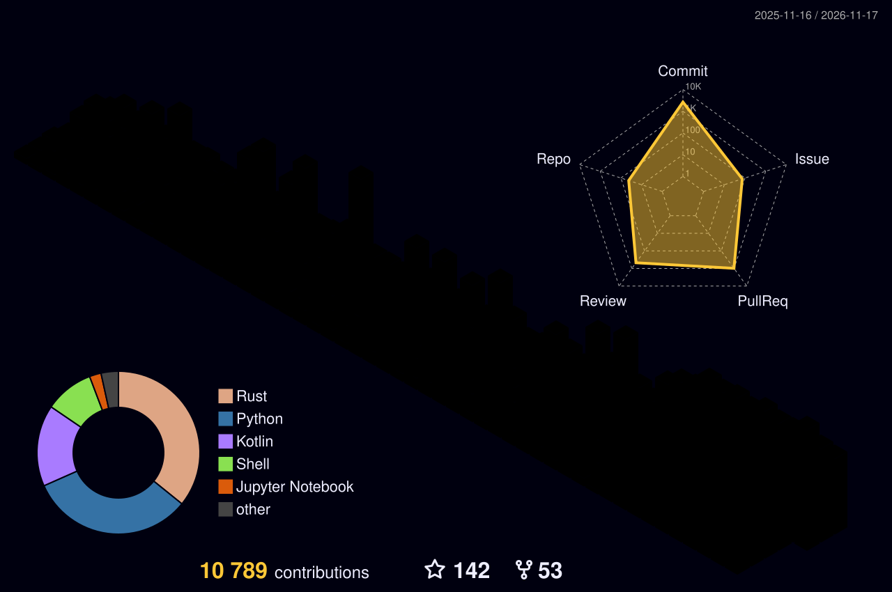

<div align="center">

<picture>
  <source media="(prefers-color-scheme: dark)" srcset="./assets/readme/header-dark.svg">
  <source media="(prefers-color-scheme: light)" srcset="./assets/readme/header-light.svg">
  
</picture>

<div align="center">
  <a href="https://github.com/onuralpszr">
    <picture>
      <source media="(prefers-color-scheme: dark)" srcset="https://readme-typing-svg.demolab.com?font=Fira+Code&size=22&pause=1000&color=4D7CFF&center=true&vCenter=true&width=600&lines=%3E_Initializing+neural+networks...;%3E_Loading+YOLO+weights...;%3E_Compiling+Rust+to+PTX...;%3E_Hello+World!+I'm+Onuralp+%F0%9F%91%8B">
      <source media="(prefers-color-scheme: light)" srcset="https://readme-typing-svg.demolab.com?font=Fira+Code&size=22&pause=1000&color=2753F5&center=true&vCenter=true&width=600&lines=%3E_Initializing+neural+networks...;%3E_Loading+YOLO+weights...;%3E_Compiling+Rust+to+PTX...;%3E_Hello+World!+I'm+Onuralp+%F0%9F%91%8B">
      
    </picture>
  </a>
</div>

<p align="center">
    
    <a href="https://www.linkedin.com/in/osezer/"></a>
    <a href="https://user-badge.committers.top/turkey_public/onuralpszr">
     </a>
    <a href="https://huggingface.co/onuralpszr"></a>
    <a href="https://onuralpsezer.com"></a>
</p>

<p align="center">
  <a href="#-researchexploring"><b>Research</b></a> ·
  <a href="#-projectsactive"><b>Projects</b></a> ·
  <a href="#-git-log---milestones"><b>Journey</b></a> ·
  <a href="#-cuda_oxidekernellaunch"><b>GPU kernels</b></a> ·
  <a href="#-osscontributions"><b>Open Source</b></a> ·
  <a href="#-speakertalks"><b>Talks</b></a> ·
  <a href="#-deploystack"><b>Stack</b></a> ·
  <a href="https://onuralpsezer.com"><b>Website ↗</b></a>
</p>

</div>

👋 **Greetings everyone!** I'm **Onuralp**, a **Senior Machine Learning Engineer [@Ultralytics](https://github.com/ultralytics)**. I work on **computer vision** with **Python**, **Rust**, **C++** and **Kotlin**: R&D on the next improvements to **YOLO**, the training code, and fast inference through **ONNX**, **TensorRT** and **ExecuTorch**, on a strong **DevOps / MLOps** foundation.

Right now I'm also **learning and experimenting with VLMs and vision embedding models**, and **contributing to the PyTorch source**. Ask me about YOLO, PyTorch, VLMs, open source and Fedora Linux.

### 🧠 `model.summary()`

```python
import torch.nn as nn

class Onuralp(nn.Module):
    def __init__(self):
        super().__init__()
        self.role = "Senior Machine Learning Engineer @Ultralytics"
        self.focus = ["YOLO R&D 🎯", "VLMs 🗣️", "Vision Embeddings 🧭", "GPU Kernels ⚡"]
        self.languages = ["Python 🐍", "Kotlin 📱", "C++ ⚙️", "Rust 🦀", "CUDA PTX ⚡"]
        self.upstream = ["PyTorch 🔥", "ExecuTorch 📱", "Fedora 🐧"]
        self.community = ["Fedora Project Contributor 🐧", "GDG Samsun Organizer 🎤"]

    def forward(self, coffee):
        code = self.write_code(coffee)
        models = self.train_yolo(code)
        return self.deploy_to_edge(models)
```

### 🚀 `inference_pipeline.run()`

From research to production, this is the path my work takes every day:

<picture>
  <source media="(prefers-color-scheme: dark)" srcset="./assets/readme/pipeline-dark.svg">
  <source media="(prefers-color-scheme: light)" srcset="./assets/readme/pipeline-light.svg">
  
</picture>

## 🔬 `research::exploring()`

| | |
|:---|:---|
| 🎯 **YOLO R&D** | Research and development on the next improvements to YOLO at Ultralytics: architectures, training recipes and the export paths that decide how fast a model really runs. |
| 🗣️ **VLMs & vision embeddings** | Learning and experimenting with Vision-Language Models and vision embedding models, where detection meets language, retrieval and open-vocabulary search. |
| 🔥 **PyTorch from the inside** | Contributing to the PyTorch source and ExecuTorch to understand the stack underneath every model I ship. |
| 🌐 **Vision in the browser** | YOLO running client-side through Ultralytics Inference compiled to WebAssembly on WebGPU. Try it live on [onuralpsezer.com](https://onuralpsezer.com) or in my [Python Pizza deck](https://pizza.onuralpsezer.com/). |

## 🧩 `projects::active()`

| Project | Role | Description | Live Stats |
|:---|:---:|:---|:---|
| [Ultralytics](https://github.com/ultralytics/ultralytics) | <code>Co&#8209;Maintainer</code> | World's leading YOLO framework for object detection, instance segmentation, semantic segmentation, depth estimation, image classification, pose estimation and oriented object detection, with tracking across video frames | <a href="https://github.com/ultralytics/ultralytics"></a> |
| [Ultralytics Inference](https://github.com/ultralytics/inference) | <code>Main&nbsp;Maintainer</code> | 🦀 High-performance YOLO inference in Rust for ONNX and OpenVINO IR models, running natively and in the browser on WebGPU, dual-published as a [crate](https://crates.io/crates/ultralytics-inference) 📦 and an [npm](https://www.npmjs.com/package/@ultralytics/yolo) package 🟢 (Node bindings) | <a href="https://github.com/ultralytics/inference"></a> <a href="https://crates.io/crates/ultralytics-inference"></a> <a href="https://www.npmjs.com/package/@ultralytics/yolo"></a> |
| [TrackForge](https://github.com/onuralpszr/trackforge) | <code>Main&nbsp;Maintainer</code> | Unified, high-performance multi-object tracking library in Rust with Python bindings: ByteTrack, DeepSORT, OC-SORT, Deep OC-SORT, BoT-SORT, TrackTrack and SORT, with pluggable Re-ID and Ultralytics integration | <a href="https://github.com/onuralpszr/trackforge"></a> <a href="https://crates.io/crates/trackforge"></a> <a href="https://pypi.org/project/trackforge/"></a> |
| [SAHI](https://github.com/obss/sahi) | <code>Co&#8209;Maintainer</code> | Slicing Aided Hyper Inference for object detection on large images | <a href="https://github.com/obss/sahi"></a> <a href="https://pypi.org/project/sahi/"></a> |
| [CvCamera-Mobile](https://github.com/onuralpszr/CvCamera-Mobile) | <code>Main&nbsp;Maintainer</code> | Android CV camera template with OpenCV and real-time ML | <a href="https://github.com/onuralpszr/CvCamera-Mobile"></a> |
| [GFPGAN-ncnn-vulkan](https://github.com/onuralpszr/GFPGAN-ncnn-vulkan) | <code>Main&nbsp;Maintainer</code> | Face restoration via GFPGAN, accelerated with ncnn + Vulkan | <a href="https://github.com/onuralpszr/GFPGAN-ncnn-vulkan"></a> |
| [PyTorch](https://github.com/pytorch/pytorch) · [ExecuTorch](https://github.com/pytorch/executorch) | `Contributor` | Contributing to the PyTorch source and its on-device runtime for edge and mobile | <a href="https://github.com/pytorch/executorch"></a> |
| [YOLO-World](https://github.com/AILab-CVC/YOLO-World) | `Contributor` | Real-time open-vocabulary object detection via text prompts | <a href="https://github.com/AILab-CVC/YOLO-World"></a> |
| [KDE](https://kde.org/) | `Contributor` | KDE ecosystem: Linux desktop and open-source community | [kde.org](https://kde.org/) |

#### 🧪 `lab::side_projects()`

| Project | Description |
|:---|:---|
| [xps-fedora](https://github.com/onuralpszr/xps-fedora) | Fedora on the Dell XPS 16 (Intel Panther Lake): kernel patches, IPU7 camera, IR face unlock, NPU and an Intel AI stack, packaged as RPMs on [COPR](https://copr.fedorainfracloud.org/coprs/thunderbirdtr/xps-fedora/) |
| [colabsh](https://github.com/onuralpszr/colabsh) | CLI for Google Colab: execute code and interact with Colab from the terminal |
| [yuko](https://github.com/onuralpszr/yuko) | Rust-backed validators for common validation tasks, as a Python package |
| [python-pizza-talk](https://github.com/onuralpszr/python-pizza-talk) | Animated slides and a live in-browser YOLO demo for Python Pizza Istanbul 2026 |

<details>
<summary><b>📜 <code>projects::past()</code></b></summary>
<br>

| Project | Description |
|:---|:---|
| [Supervision](https://github.com/roboflow/supervision) | Reusable CV tools for detections, annotations and datasets (former co-maintainer) |
| [Supervision Conda Forge](https://github.com/conda-forge/supervision-feedstock) | Conda package distribution for Supervision |
| [Gemma Cookbook](https://github.com/google-gemini/gemma-cookbook) | Guides and examples for Google Gemma |
| [Sceneview-android](https://github.com/SceneView/sceneview-android) | ARCore and 3D rendering for Android |
| [Sceneform-android](https://github.com/SceneView/sceneform-android) | ARCore SDK for Android from the SceneView team |
| [Nvidia Auto Installer](https://github.com/t0xic0der/nvidia-auto-installer-for-fedora) | Automated NVIDIA driver installer for Fedora Linux |

</details>

## 📈 `git log --milestones`

```console
$ git log --oneline --milestones --author="Onuralp"
2026  🍕 model.predict(): real-time edge vision talk at Python Pizza Istanbul
2026  🛠️ No GPU Left Behind: hybrid YOLO training workshop at GDG Samsun DevFest
2026  🦀 Created TrackForge: Rust multi-object tracking (ByteTrack, DeepSORT, OC-SORT, BoT-SORT, TrackTrack and more) + Python bindings
2025  🚀 Main maintainer of ultralytics/inference: Rust YOLO inference, dual-shipped to crates.io + npm
2024  🧠 Senior ML Engineer @Ultralytics, co-maintaining YOLO (detect, segment, semantic, depth, classify, pose, OBB)
2023  🔬 Co-maintainer @ SAHI · former co-maintainer @ Supervision (Roboflow)
2022  🌱 First Hacktoberfest, 4 consecutive years and counting (Holopin 10 Badge Club)
2021  🐧 Fedora RPM packager & KDE SIG member, shipping AI/ML libs to ~40M users
2016  🎤 Speaker at Flock to Fedora and BalCCon (also BalCCon 2015)
2013  🎤 Speaker at OSOL Conference Szeged · Fedora 18-20 QA & Anaconda testing
2012  👋 git init: joined GitHub · FUDCon Paris
2011  🎉 Fedora 16 release party in Tokat, the first of many Fedora events
```

<picture>
  <source media="(prefers-color-scheme: dark)" srcset="./assets/readme/contributions-dark.svg">
  <source media="(prefers-color-scheme: light)" srcset="./assets/readme/contributions-light.svg">
  
</picture>

<details>
<summary><b>🧬 <code>model.fit(epochs=1000)</code></b></summary>
<br>

<div align="center">

| `Epoch 1` | `Epoch 50` | `Epoch 100` |
|:---:|:---:|:---:|
| 🔲🔳🔲🔳🔳🔲🔳🔲<br>🔳🔲🔳🔲🔲🔳🔲🔳<br>🔲🔳🔲🔳🔳🔲🔳🔲<br>🔳🔲🔳🔲🔲🔳🔲🔳<br>🔲🔳🔲🔳🔳🔲🔳🔲<br>🔳🔲🔳🔲🔲🔳🔲🔳<br>🔲🔳🔲🔳🔳🔲🔳🔲<br>🔳🔲🔳🔲🔲🔳🔲🔳 | ⬛⬛⬛🟪🟪⬛⬛⬛<br>⬛⬛🟪🟪🟪🟪⬛⬛<br>⬛🟪🟪🟪🟪🟪🟪⬛<br>⬛🟪🟪🟪🟪🟪🟪⬛<br>⬛⬛🟪🟪🟪🟪⬛⬛<br>⬛⬛⬛🟪🟪⬛⬛⬛<br>⬛⬛⬛⬛⬛⬛⬛⬛<br>⬛⬛⬛⬛⬛⬛⬛⬛ | 🟥🟥🟥🟥🟥🟥🟥🟥<br>🟥⬛⬛⬛⬛⬛⬛🟥<br>🟥⬛🟦⬛⬛🟦⬛🟥<br>🟥⬛⬛⬛⬛⬛⬛🟥<br>🟥⬛⬛🟦🟦⬛⬛🟥<br>🟥⬛⬛⬛⬛⬛⬛🟥<br>🟥🟥🟥🟥🟥🟥🟥🟥<br>⬛⬛⬛⬛⬛⬛⬛⬛ |
| *Raw Data (Noise)* | *Feature Extraction* | *YOLO Object Detected!* |

</div>

```console
[Epoch 001] 🟢⚪⚪⚪⚪⚪⚪⚪⚪⚪ (Learning Python & C++)
[Epoch 050] 🟢🟢🟢⚪⚪⚪⚪⚪⚪⚪ (Mastering Computer Vision & OpenCV)
[Epoch 100] 🟢🟢🟢🟢🟢⚪⚪⚪⚪⚪ (Training YOLO & Deep Learning Models)
[Epoch 500] 🟢🟢🟢🟢🟢🟢🟢⚪⚪⚪ (Optimizing with ONNX, TensorRT & Rust)
[Epoch 999] 🟢🟢🟢🟢🟢🟢🟢🟢🟢🟢 (Deploying AI @ Ultralytics 🚀)

> Model 'Onuralp' successfully converged.
> Current State: Senior ML Engineer Lv2
> Next Objective: AGI & Beyond...
```

</details>

## ⚡ `cuda_oxide::kernel::launch()`

Currently exploring **[cuda-oxide](https://nvlabs.github.io/cuda-oxide/)**, an experimental Rust-to-CUDA compiler from NVIDIA Research that compiles safe(ish), idiomatic Rust directly to PTX. No CUDA C, no DSLs, no foreign bindings: just Rust running on the GPU.

<table>
<tr>
<td width="55%" valign="top">

```rust
// 🦀 Rust compiles straight to PTX
#[kernel]
pub unsafe fn vector_add(a: &[f32], b: &[f32], c: &mut [f32]) {
    let tid = thread::index_1d() as usize;
    if tid < c.len() {
        c[tid] = a[tid] + b[tid]; // thousands of threads, one instruction
    }
}
```

</td>
<td width="45%" valign="top">

```console
$ cargo build --target nvptx64-nvidia-cuda
   ✅ Rust -> LLVM IR -> PTX
   ✅ Kernel compiled: vector_add.ptx
> Launching 4096 threads across 128 warps...
> All threads converged. ✅
> Status: still learning, the 🦀 loves the GPU
```

</td>
</tr>
</table>

## 🌍 `oss::contributions()`

```rust
let platforms = vec!["GitHub", "GitLab", "Pagure"];
let mission   = "build together, make open source better for everyone 🌍";
```

<table>
<tr>
<td width="50%" valign="top">

### 🐧 Fedora Project

Contributor **since 2011**: **Mindshare Member**, **KDE SIG Member**, **Websites & Apps Team Member** and **RPM Packager** ([wiki](https://fedoraproject.org/wiki/User:Thunderbirdtr)). I package Python, KDE, Qt and AI/ML libraries for the official Fedora repositories, bringing cutting-edge open source tools to millions of users. **157 Fedora badges**, talks at Flock, and two Fedora Magazine articles: *Use OpenCV on Fedora Linux* [Part 1](https://fedoramagazine.org/use-opencv-on-fedora-linux-part-1/) · [Part 2](https://fedoramagazine.org/use-opencv-on-fedora-linux-part-2/).

```console
$ fedpkg prep       # ✅ sources verified, patches applied
$ fedpkg mockbuild  # ✅ x86_64, aarch64
$ fedpkg push && fedpkg submit
> Update pushed to stable → ~40M Fedora users
```

</td>
<td width="50%" valign="top">

### 🎤 GDG Samsun

**Organizer & Speaker** at [GDG Samsun](https://gdgsamsun.org/), sharing insights on **Deep Learning**, **Computer Vision**, **LLMs / RAG** and **Vision-Language Models**.

### 🌱 Hacktoberfest

`2022` ✅ `2023` ✅ `2024` ✅ `2025` ✅

Four consecutive years, dozens of PRs, a spot in the **Holopin x Hacktoberfest 10 Badge Club**, and somewhere out there **a tree growing in my name** 🌳. For me it's about **people, learning and giving back**.

</td>
</tr>
</table>

I co-maintain **[SAHI](https://github.com/obss/sahi)** and was previously a co-maintainer of **[Supervision](https://supervision.roboflow.com/)**. I also contribute to the **[PyTorch](https://github.com/pytorch/pytorch)** source, **[ExecuTorch](https://github.com/pytorch/executorch)** and **[ONNXSlim](https://github.com/inisis/OnnxSlim)**, plus many FLOSS projects across GitHub, GitLab and Pagure.

## 🎤 `speaker::talks()`

| When | Talk | Event | |
|:---|:---|:---|:---:|
| `Dec 2026` | [Nerede? Turkish-English Semantic Search with EmbeddingGemma 2](https://onuralpszr.github.io/nerede/) | GDG DevFest İstanbul 2026 | 📝 proposal |
| `Nov 2026` | [model.predict(): Real-Time Edge Vision with Ultralytics](https://pizza.onuralpsezer.com/) | Python Pizza Istanbul 2026 | 🍕 live demo |
| `Oct 2026` | [No GPU Left Behind: Hybrid Ultralytics YOLO Training and Fast Execution](https://onuralpszr.github.io/gdg-samsun-etkinlik-2026-workshop/) | GDG Samsun DevFest 2026 | 🛠️ workshop |
| `Jun 2025` | [Computer Vision with Supervision](./Presentations/openSUSE-Conf-2025/supervision-computer-vision) | openSUSE Conference 2025 | 🐍 code |
| `May 2025` | [Fedora 42 KDE Plasma Desktop Edition](./Presentations/Fedora/Fedora%2042%20KDE%20Plasma%20Desktop%20Edition%20Release%20Party%20Slides.pdf) | Fedora 42 Release Party | 📄 slides |
| `Dec 2024` | [What’s new in Fedora 41](./Presentations/Samsun/Samsun_Fedora41_Release_Slides/Fedora_Samsun.pdf) | Fedora 41 Release Party · Samsun | 📄 slides |
| `Jun 2024` | [LLMs & Retrieval-Augmented Generation](./Presentations/Samsun/Samsun_GDG_LLM_RAG_Jun_1_2024/GDG%20Samsun%20-%20LLM_RAG.pdf) | GDG Samsun | 📄 slides |
| `Apr 2024` | [Computer Vision with Supervision](./Presentations/Samsun/Samsun_GDG_AI_Summit_April_7_2024/Supervision_Samsun_GDG.pdf) | GDG Samsun AI Summit | 📄 slides |
| `Apr 2024` | [On-device ML with Flutter & TFLite](./Presentations/Samsun/Samsun_GDG_AI_Summit_April_7_2024/Flutter_Tflite_Samsun_GDG.pdf) | GDG Samsun AI Summit | 📄 slides |
| `Feb 2024` | [Fedora Linux Meetup](./Presentations/Samsun/Fedora_Feb24_2024_Samsun.pdf) | Fedora · Samsun | 📄 slides |
| `Aug 2022` | [State of Gaming on Fedora Workstation](./Presentations/Samsun/Samsun_Fedora41_Release_Slides/NestWithFedora2022_1854IST_06Aug2022_FWStateOfGaming.pdf) | Nest with Fedora 2022 | 📄 slides |
| `Aug 2021` | [Fedora & Plasma Mobile](./Presentations/Nest_2021_Talk_Fedora_Plasma_Mobile.pdf) | Nest with Fedora 2021 | 📄 slides |
| `2016` | Speaker | [Flock to Fedora 2016](https://fedoraproject.org/wiki/Flock_2016) | 🎤 |
| `2016` | Speaker | [BalCCon 2k16](https://2k16.balccon.org/) | 🎤 |
| `2015` | Speaker | [BalCCon 2k15](https://2k15.balccon.org/) | 🎤 |
| `2013` | Speaker | OSOL Conference Szeged 2013 | 🎤 |

## 🔧 `deploy::stack()`

```python
stack = {
    "training":  ["PyTorch", "Ultralytics", "TensorFlow", "JAX", "Keras"],
    "inference": ["ONNX Runtime", "TensorRT", "ExecuTorch", "ncnn", "Vulkan", "OpenVINO"],
    "gpu":       ["CUDA", "cuda-oxide", "PTX", "NVIDIA TensorRT", "WebGPU"],
    "research":  ["YOLO R&D", "VLMs", "Vision Embeddings", "Tracking"],
    "backend":   ["Python", "FastAPI", "Django", "Flask"],
    "mobile":    ["Kotlin", "Flutter", "ARCore", "MediaPipe", "Firebase"],
}
```

On mobile I work with **Kotlin** and **Flutter** alongside [ARCore](https://developers.google.com/ar), [MediaPipe](https://mediapipe.dev/), [Firebase](https://firebase.google.com/), [FlatBuffers](https://flatbuffers.dev/), [ONNX Runtime](https://onnxruntime.ai/) and [ncnn](https://github.com/Tencent/ncnn). **[PyTorch](https://pytorch.org/)** is my primary deep learning framework, with [TensorFlow](https://www.tensorflow.org), [TensorBoard](https://www.tensorflow.org/tensorboard), [Keras](https://keras.io/) and [JAX](https://github.com/google/jax) for experiments and cross-framework work.

<details>
<summary><b>🧰 Full arsenal: languages, frameworks, tools, platforms</b></summary>
<br>

<h3 align="left">Programming</h3>
<p>
    
    
    
    
    
    
    
    
    
    
    

</p>

<h3 align="left">Backend-as-a-Service (Baas)</h3>
<p>
   
      
</p>

<h3 align="left">Web Servers</h3>
<p>
   
   
   
</p>

<h3 align="left">Framework & Libraries</h3>
<p>
  
  
  
  
  
  
  
  
  
  
  
  
  
  
  
  
   <a href="#"></a>
</p>

<h3 align="left">Game Engines</h3>
<p>
    
    
    

</p>

<h3 align="left">Databases</h3>
<p>
    <a href="#"></a>
    <a href="#"></a>
    <a href="#"></a>
    <a href="#"></a>
</p>

<h3 align="left">VPN Servers</h3>
<p>
    <a href="#"></a>
    <a href="#"></a>
</p>

<h3 align="left">Virtualization Platforms</h3>
<p>
    <a href="#"></a>
    <a href="#"></a>
    <a href="#"></a>
    <a href="#"></a>
</p>

<h3 align="left">Software and tools</h3>
<p>
    <a href="#"></a>
    <a href="#"></a>
    <a href="#"></a>
    <a href="#"></a>
    <a href="#"></a>
    <a href="#"></a>
    <a href="#"></a>
    <a href="#"></a>
    <a href="#"></a>
    <a href="#"></a>
    <a href="#"></a>
    <a href="#"></a>
    <a href="#"></a>
    <a href="#"></a>
    <a href="#"></a>
    <a href="#"></a>
    <a href="#"></a>
    <a href="#"></a>
    <a href="#"></a>
    <a href="#"></a>
    <a href="#"></a>
</p>

<h3 align="left">Linux Distributions</h3>
<p>
    <a href="#"></a>
    <a href="#"></a>
    <a href="#"></a>
    <a href="#"></a>
    <a href="#"></a>
    <a href="#"></a>
</p>

<h3 align="left">Platforms</h3>
<p>
    <a href="#"></a>
    <a href="#"></a>
    <a href="#"></a>
</p>

<h3 align="left">Cloud Providers</h3>
<p>
    <a href="#"></a>
    <a href="#"></a>
    <a href="#"></a>
</p>

</details>

## 📊 `stats.render()`

<p align="center">
  
  
</p>



## 🔗 `links::connect()`

I'm always open to collaborating, contributing, or just talking about open source, computer vision and AI. 🚀

<p align="center">
  <a href="https://www.linkedin.com/in/osezer/"></a>
  <a href="https://twitter.com/onuralpszr"></a>
  <a href="https://huggingface.co/onuralpszr"></a>
  <a href="https://www.credly.com/users/onuralp-sezer/badges"></a>
  <a href="https://developers.google.com/profile/u/onuralpsezer"></a>
  <a href="https://www.cloudskillsboost.google/public_profiles/aa921c43-e963-4266-aa26-e7465dab9aec"></a>
  <a href="https://ask.fedoraproject.org/u/thunderbirdtr/"></a>
  <a href="https://pagure.io/user/thunderbirdtr"></a>
  <a href="https://src.fedoraproject.org/user/thunderbirdtr/"></a>
  <a href="https://fedoraproject.org/wiki/User:Thunderbirdtr"></a>
  <a href="https://badges.fedoraproject.org/user/thunderbirdtr"></a>
</p>

<table>
<tr>
<td width="33%" valign="top" align="center">

**🤝 `mentorship::programs()`**

<p align="center">
  <a href="https://github.com/outreachy"></a>
  <a href="https://github.com/OpenTRFoundation/OpenTR"></a>
</p>

</td>
<td width="34%" valign="top" align="center">

**🙌 `volunteer::work()`**

<p align="center">
  <a href="https://fedoraproject.org/wiki/User:Thunderbirdtr"></a>
  <a href="https://kde.org/"></a>
  <a href="https://www.opensuse.org/"></a>
  <a href="https://gdg.community.dev/gdg-samsun/"></a>
  <a href="https://gdgsamsun.org/"></a>
</p>

</td>
<td width="33%" valign="top" align="center">

**🏅 `certifications::earned()`**

<p align="center">
  <a href="https://www.credential.net/5d4c2d99-4c0b-4990-9399-2bdb496f7d4f#gs.axwujf"></a>
  <a href="#"></a>
</p>

</td>
</tr>
</table>

<div align="center">

[](https://holopin.io/@osezer)

<picture>
  <source media="(prefers-color-scheme: dark)" srcset="./assets/readme/footer-dark.svg">
  <source media="(prefers-color-scheme: light)" srcset="./assets/readme/footer-light.svg">
   Model 'Onuralp' successfully converged. Next objective: AGI &amp; beyond..." src="./assets/readme/footer-dark.svg" width="100%">
</picture>

</div>
